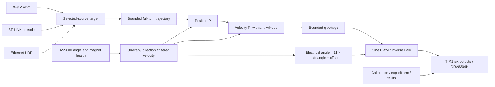

# Firmware and bench bring-up guide

Updated 2026-10-08. Firmware v0.1.0. Software builds/tests pass; all electrical and motion checks below remain pending. This is a single unloaded-motor proof of concept on dev boards.

## What each piece does

`board.c` binds clocks, pins, six PWM outputs, hardware break, asynchronous encoder/ADC acquisition and watchdog. It translates hardware into coherent samples and applies/inhibits PWM. `motor_control.c` is HAL-independent: it owns calibration, feedback unwrap, state, trajectory, position P, velocity PI, anti-windup and sine modulation. `demo_app.c` runs the 1 kHz integration step and provides a latest-target mailbox plus one pending action. `demo_console.c` parses ST-LINK serial in foreground. `demo_network.c` runs LwIP raw UDP in foreground with DMA-owned packet buffers. `demo_protocol.c` validates integer values, packet syntax and sequence order.



This is encoder-oriented **voltage-mode sinusoidal control**. It uses d/q voltage coordinates but does not measure or regulate d/q current. Velocity PI returns volts; it does not return amperes or guarantee torque. Current FOC will add PWM-synchronized low-side current acquisition, Clarke/Park transforms and inner d/q current PI loops. Phase-voltage sensing, bus/current scaling, CAN, second axis and vision are not implemented in this dev profile.

## Initial limits

All numeric settings are in `Core/Inc/demo_config.h`, with units. Starting values need bench tuning:

| Quantity | Starting value |
| --- | --- |
| Configured bus | 24 V; **not measured** by this firmware |
| Alignment d voltage | Ramps to 1 V over 0.5 s |
| Running q voltage | ±2 V |
| Trajectory speed | 0.4 rad/s ≈22.9°/s |
| Trajectory acceleration | 0.4 rad/s² ≈22.9°/s² |
| Position gain | 3 (rad/s)/rad |
| Velocity gains | P=1 V/(rad/s); I=2 V/rad |
| Velocity filter | 50 ms time constant, updated only on new encoder samples |
| Encoder / health maximum age | 8 ms / 60 ms |
| Analog ADC maximum age | 20 ms; readings above 3.15 V invalid |
| Foreground maximum age | 100 ms while excitation is active |
| SERIAL / ETHERNET command lease | 500 ms; only accepted POSITION/HEARTBEAT refresh it |
| Following error | >30° between trajectory reference and feedback trips TRACKING |
| Travel fault margin | Feedback below −5° or above 365° trips TRAVEL |

Motion references stay in 0–360°. Measured position can briefly exceed an endpoint while settling; the 5° margin is fault detection, not a hard mechanical stop. The acceleration cap applies to the trajectory reference, not guaranteed physical acceleration. A full-turn trajectory at these defaults takes about 17 seconds; allow settling afterward. The earlier 2 s settling proposal cannot mean completing a full turn in 2 s with this cap.

Voltage limiting does not establish a 4 A phase-current trip. The bench supply limits bus current and the EVM has its configured hardware protection; neither substitutes for calibrated phase-current regulation. Begin with a low supply current limit (for example 0.2–0.3 A after measuring idle consumption), then adjust deliberately if calibration cannot complete without supply collapse. Stop and inspect waveforms/current instead of repeatedly increasing alignment voltage. Monitor motor/EVM temperature during holds.

## Build and tests

From the DEV project directory, with Python and STM32CubeIDE ARM GCC installed:

```powershell
python Tools/build.py --config Debug
python Tools/build.py --config Release
```

The script discovers ARM GCC under `C:/ST/STM32CubeIDE_*/...`; pass `--toolchain <bin-directory>` for another installation. It builds all application/HAL/LwIP sources, treats application warnings as errors, and emits ELF/BIN/HEX/map under `build/Debug` or `build/Release`. CubeIDE's native Debug/Release builds use the same source directories and linker. Refresh/rebuild the project after external edits. Use the FLASH linker; the retained original RAM linker is not a validated alternate demo build.

Host tests execute the actual portable C modules and the Python client over localhost. A native C compiler is required:

```powershell
python Tools/test.py --cc clang
# Or: python Tools/test.py --zig <path-to-zig.exe>
```

Tests cover positive/negative calibration, failed/stalled calibration, full-turn/reversal motion references, speed/acceleration/effort bounds, tracking errors, stale inputs, fault/arm/disable interlocks, angle/time wrap, malformed/overflow/replay sequences, and client wire format. They do not emulate TIM1, ADC, I2C, the Ethernet MAC/PHY or physical motor dynamics. [VALIDATION.md](VALIDATION.md) separates software evidence from bench acceptance.

## Logic and sensing first

1. Verify the [harness/configuration](BOARD_CONFIG.md) with power disconnected. Supply the Nucleo via ST-LINK USB. Leave the motor bus off initially.
2. Flash the ELF using CubeIDE/ST-LINK with motor supply disconnected. Run freely; do not halt/debug while energized. The watchdog is not frozen in debug, and electrical shutdown during arbitrary CPU halt has not been validated. The external ENABLE pull-down is required for reset/unpowered MCU behavior.
3. Open ST-LINK VCP at **115200, 8N1**, no flow control. Use uppercase commands terminated by CR or LF. `HELP` lists commands. The banner appears after initialization. `STATUS` should show inhibited state.
4. Hand-turn the motor slowly. Check raw angle, direction consistency, magnet=1, encoder/status ages and angle wrap. A missing/failed encoder boot configuration needs wiring repair and reboot; there is no active-drive bus recovery.
5. Apply measured 0 /0.75 /1.5 /2.25 /3 V to PA3. Check ADC raw values approximately 0 /14895 /29789 /44684 /59577 with actual VDDA near 3.3 V. Meter VDDA and adjust `DEMO_ADC_VREF` for endpoint accuracy. Add source impedance/series protection appropriate to the bench source. Never connect the 24 V motor bus to PA3 or the encoder.

## PWM and shutdown before motion

With the motor disconnected, apply the EVM bus and verify 3.3 V logic supply, ENABLE default low, MODE=6 PWM, CAL low, nFAULT pull-up and EVM hardware straps. Scope **all six** MCU/EVM input signals for complementary pairing, nominal 20 kHz carrier, 500 ns deadtime and inactive outputs when disabled. Calibration requires encoder health, but can be invoked with the healthy encoder attached and winding leads disconnected to inspect low-energy excitation; it should eventually fail calibration, then inhibit.

Inject nFAULT low only through an appropriate open-drain/grounding arrangement; verify hardware clears MOE and all drive inputs go inactive, ENABLE goes low, a fault latches, and no automatic restart occurs. Check DISABLE, `!`, reset, encoder loss, watchdog and supply transitions. Verify the expected wake/sleep nFAULT pulses do not cause false start or repeated wake. Record measured inhibition latency. Do not proceed to motor connection until these checks pass.

## Analog motion milestone

Secure the unloaded motor with enough clearance for calibration and a complete revolution. Keep cables from winding up. Maintain an accessible bus power cutoff.

1. Set analog input to 0 V. Connect winding leads with power off, then apply current-limited 24 V.
2. Issue `CALIBRATE`. This authorizes motion: wake (10 ms, PWM inhibited), stationary alignment (2 s), +90° **electrical** sweep with settle (2.5 s, about 8.18° mechanical for 11 pole pairs), then return and settle (2.5 s). It accepts movement magnitude only within ±50% of expectation and requires return within about 2°. Direction and electrical offset are stored in RAM. On success state becomes READY with drive off.
3. With drive disabled, put the shaft at the intended mechanical 0° fixture orientation and issue `ZERO`. This is a requested current-position reference, not automatic homing. `STATUS` must show cal=1, zero=1. Reboot/CLEAR_FAULT requires recalibration and a new zero.
4. Issue `ARM`, then check `STATUS`. Commands report QUEUED, not proof that an action was applied; the control loop still checks freshness and prerequisites. During ARM_WAKE PWM stays inhibited, then the running trajectory starts at measured position and ramps toward the selected target.
5. First try small increases (for example 5–10°), then 90°, 180°, 270°, 360°, and return to 0°. The standard voltage points are 0/0.75/1.5/2.25/3 V. Verify direction, hold current/temperature, error and settling before increasing gains/effort.
6. `DISABLE` or the single character `!` immediately inhibits and coasts. A loaded gimbal can fall when disabled; loaded-axis holding is a later policy. `!` is handled in the UART ISR, bypasses queued lines, and cancels pending actions. DISABLE itself is handled in foreground, while typed `!` works even during a foreground stall.

`FAULT` remains latched. Resolve the cause, then `CLEAR_FAULT` returns to DISABLED, clears calibration/reference authority, and requires CALIBRATE → ZERO → ARM again. `SOURCE ANALOG|SERIAL|ETHERNET` changes ownership only while inhibited; it invalidates previous commands. After a source change or fault clear, a new POSITION is required before HEARTBEAT is accepted. Serial POSITION is in **millidegrees**, e.g. `POSITION 90000`, and requires renewed POSITION or HEARTBEAT within 500 ms when running. A manually typed serial target alone will expire, so analog is easier for first tuning.

## Ethernet milestone

Proceed after analog move/hold/disable is repeatable. Connect the Nucleo RJ45 to the laptop or a bench switch. Firmware IP **192.168.10.2/24**, no DHCP/gateway; laptop interface **192.168.10.1/24**. Account for the laptop firewall. `STATUS eth=LINK_UP` verifies the firmware link check; `INIT_FAILED` requires fixing PHY/RMII/clock and rebooting. Analog operation is available even if Ethernet initialization fails.

1. `DISABLE`, then `SOURCE ETHERNET` on VCP. Keep successful calibration/zero from the analog tests, or establish them again.
2. In the DEV project directory:

   ```powershell
   python Tools/udp_client.py --angle 0 --hold
   ```

   Use current measured angle instead of 0 if needed. This starts a session and sends heartbeats, but does not arm.
3. Issue `ARM` on VCP. Type degree targets such as `10`, `90`, `180` in the laptop client's console. Firmware uses the same trajectory/servo as analog. Client prints status about once per second.
4. Enter `quit` or Ctrl+C to send DISABLE. Killing the client, unplugging Ethernet or stopping heartbeat must fault/coast within the command lease plus one servo tick. STATUS/ping do not refresh the lease. A lost acknowledgement makes the supplied client disable conservatively.

Strict ASCII UDP payloads, with no newline or NUL terminator:

```text
G1 <nonzero uint32 session> <uint32 sequence> POSITION <0..360000 millidegrees>
G1 <session> <sequence> HEARTBEAT
G1 <session> <sequence> STATUS
G1 <session> <sequence> DISABLE
```

Accepted POSITION/HEARTBEAT receive `OK G1 <session> <sequence>`. STATUS returns the same status text as VCP. DISABLE returns `OK DISABLED` and may be sent by any bench client as a stop. Syntax/range/source/owner/sequence failures return ERR and do not refresh authority. There is no UDP ARM, ZERO or CALIBRATE. One source IP/UDP port/session owns commands; another owner can acquire via POSITION only while inhibited and after the old lease expires. Duplicate/older sequences are rejected using unsigned half-range comparison. Status requests do not acquire ownership. This bench protocol provides freshness/ownership checks; authentication for a deployed network is future work.

## Tuning and next steps

Tune one thing at a time, with scope/current observation: electrical calibration and positive effort first, then velocity PI/noise filter, then position gain and trajectory limits. TRACKING may indicate insufficient effort, bad phase order/alignment, friction or loop tuning; TRAVEL may indicate wrong feedback sign or endpoint behavior. Do not raise limits to hide a sign fault. A 12-bit encoder has quantized velocity; filter/gains require actual motion evidence.

Record results in [VALIDATION.md](VALIDATION.md), including supply limit, motor phase order, EVM straps, VDDA, UART/PWM/I2C timings, max control execution, calibration direction, errors and fault latency. Current FOC requires separate EVM shunt/gain/bus-divider verification, offset calibration, PWM-triggered valid low-side windows and inner-loop tests before increasing torque. H743 migration needs its own clocks, DRV8304S SPI configuration, current/bus scaling, shared ADC schedule and two-axis shutdown design.
